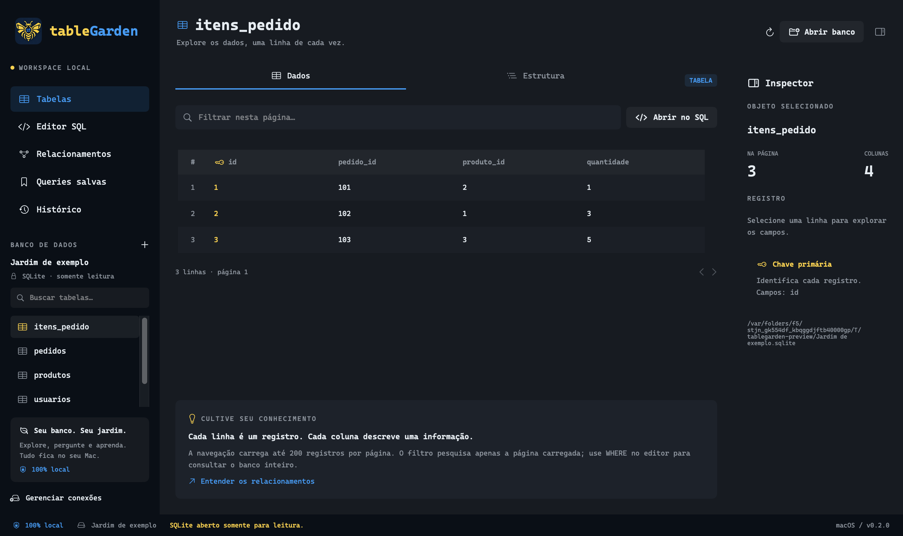

# tableGarden

Cliente nativo de bancos de dados para macOS, em Swift, SwiftUI e AppKit. Fonte Cascadia Code incorporada, armazenamento e consultas locais. Sem conta, API paga ou serviço de nuvem.



## Versão 0.2.0 — SQLite real

- Abrir arquivos SQLite existentes **somente para leitura**.
- Criar um banco de exemplo real para explorar o aplicativo sem arquivos próprios.
- Listar tabelas e views; ler colunas, chaves primárias, valores padrão, índices e definição SQL.
- Navegar em páginas de 200 registros; filtrar somente a página carregada.
- Executar SQL real em segundo plano, com cancelamento e limite de 60 segundos.
- Até 10 comandos de leitura por execução e 1.000 linhas por resultado, com aviso quando houver mais linhas.
- Parâmetros vinculados pelo SQLite: use `?` no SQL e uma lista JSON como `[1, "Ana", null]`. Cada comando usa a mesma lista. Para comandos com parâmetros diferentes, execute separadamente.
- Ver cada resultado com nomes de colunas, valores e duração. NULL, textos, inteiros de 64 bits, reais e BLOBs são diferenciados internamente; o BLOB mostra tamanho e uma prévia hexadecimal.
- Consultar chaves estrangeiras reais; cardinalidade não é presumida apenas pela existência de uma FK.
- Salvar/excluir queries, manter o rascunho do editor e reabrir arquivos recentes.
- Histórico das últimas 500 execuções, incluindo erros e cancelamentos, persistido no Mac.
- Falhas de conexão preservam a conexão anterior. Arquivos inválidos ou inexistentes não são substituídos nem criados.

Os dados de exemplo não são mais resultados fixos: são lidos de um arquivo SQLite que o app cria quando solicitado.

## Usar

Abra `build/tableGarden.app`. Clique em **Abrir banco** ou **Criar banco de exemplo**. Selecione uma tabela para explorar. Use **Abrir no SQL** para começar uma consulta ou vá ao editor e execute com **⌘Return**.

Atalhos: **⌘O** abre um arquivo SQLite; **⌘R** atualiza a conexão e a estrutura.

O filtro da grade pesquisa a página carregada. Use `WHERE`, `ORDER BY` e `LIMIT/OFFSET` no editor para consultar o conjunto completo. Objetos sem chave primária não têm ordenação estável garantida entre páginas; alterações feitas por outros aplicativos também podem mudar a paginação.

## Dados do aplicativo

Em uso normal:

```text
~/Library/Application Support/tableGarden/tablegarden.sqlite
~/Library/Application Support/tableGarden/Jardim de exemplo.sqlite
```

O primeiro guarda queries, rascunho, histórico e caminhos recentes. O segundo só é criado ao escolher o exemplo. Arquivos externos são abertos em modo read-only, com operações de gravação, anexação de outros bancos e alteração de configurações bloqueadas. Extensões SQL nativas não são carregadas.

O histórico guarda o texto SQL e o caminho do banco. Não há criptografia própria nesta etapa. Os parâmetros informados separadamente não são persistidos; ao reabrir uma consulta parametrizada, informe seus valores novamente.

A lista de queries do protótipo anterior é importada na primeira inicialização sem dados de queries no novo armazenamento.

## Desenvolvimento

Requer macOS 15+ e Xcode com Swift 6. Sem pacotes de terceiros: usamos SQLite fornecido pelo macOS.

Abra `Package.swift` no Xcode e execute TableGarden. Para gerar um `.app` independente:

```sh
./scripts/build-app.sh
open build/tableGarden.app
```

Para os testes:

```sh
CLANG_MODULE_CACHE_PATH="$PWD/.build/clang-cache" swift test --disable-sandbox
```

A biblioteca `GardenCore` contém execução SQLite, metadados, tipos e armazenamento local. `DatabaseService` e `LocalStore` isolam as operações em atores separados da interface. O cancelamento usa uma flag sincronizada consultada pelos callbacks de progresso/espera do SQLite.

Limites iniciais: SQL até 1 MB; resultados até 16 MB por execução e até 1 MB por célula; 5.000 tabelas/views; 5.000 vínculos de chaves estrangeiras. Não há contagem completa automática de registros. O tempo mostrado por resultado mede a obtenção das linhas, sem incluir toda a preparação da consulta.

Capturas de desenvolvimento usam armazenamento isolado na pasta temporária e não alteram o histórico do usuário:

```sh
build/tableGarden.app/Contents/MacOS/TableGarden --snapshot /tmp/tablegarden-tabelas.png
build/tableGarden.app/Contents/MacOS/TableGarden --query-preview --snapshot /tmp/tablegarden-query.png
build/tableGarden.app/Contents/MacOS/TableGarden --section Relacionamentos --snapshot /tmp/tablegarden-relacoes.png
```

## Ainda não implementado

Edição de dados, criação genérica de bancos, transações de escrita, PostgreSQL/MySQL, autocompletar contextual, explicação automática de SQL, planos de execução, diagrama com zoom, gráficos e dashboards. As fases permanecem no [plano](docs/PLANO.md).

Assinatura ad hoc para desenvolvimento local. Sem notarização ou validação em Apple Silicon nesta entrega.

## Identidade visual

Referências: [Endpoint Mapper](https://github.com/Mercuttius/endpointMapper-macos) e [WebhookBox 0.2.1](https://github.com/Mercuttius/webhookBox-macOS/releases/tag/v0.2.1). Barra lateral azul #090F17, área principal cinza #161B22 (referência: inspector do Endpoint Mapper), superfícies #1C222B e acentos azul/amarelo. Conteúdo próprio em Cascadia Code; menus e diálogos gerenciados pelo macOS mantêm a fonte do sistema.

Logo original preservado em `Sources/TableGarden/Resources/Branding/logo.png`; a interface usa `logo-sidebar.png` com transparência. [Cascadia Code e licença SIL OFL](https://github.com/google/fonts/tree/main/ofl/cascadiacode) incluídas no pacote.
